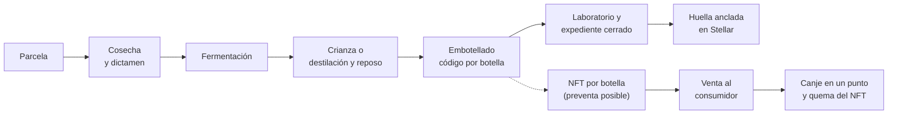

# 01 · Producto

## El problema

- Las bodegas y destilerías bolivianas, en especial las de **Singani con Denominación de Origen** y vinos de altura de Tarija y Cinti, no tienen una forma sencilla de **demostrar** el origen y la elaboración de cada botella.
- El consumidor no puede distinguir una botella auténtica de una falsificada ni conocer su recorrido real.
- Los productores pequeños dependen de intermediarios para vender y no tienen herramientas para **preventas** que les adelanten ingresos.

## La solución

| Pilar | Qué hace |
|---|---|
| **ERP de trazabilidad** | La bodega registra cada paso del lote: parcela, cosecha, dictamen fitosanitario, fermentación, crianza o destilación y reposo, embotellado y laboratorio. El sistema aplica las reglas normativas (por ejemplo, para el Singani: altitud mínima de 1 600 msnm, 100 % uva Moscatel de Alejandría y 180 días de reposo) y **no permite saltarlas** |
| **Pasaporte digital** | Cada botella lleva un código único en un QR. Al escanearlo, cualquiera ve el origen y la elaboración del lote y comprueba matemáticamente que esa botella pertenece a un expediente cerrado que no se puede alterar |
| **Tokenización** | Cada botella se representa con un NFT en la red Stellar. La bodega puede vender en preventa; el comprador recibe su NFT y lo canjea por la botella física en un punto de canje, donde el NFT se destruye (se "quema") |

**El consumidor no necesita saber de criptomonedas**: paga en bolivianos y la plataforma custodia su dirección en la red.

## Usuarios

| Usuario | Qué hace en la plataforma |
|---|---|
| Bodega (dueño, enólogo, agrónomo, operario, contador) | Registra la producción en el ERP, cierra el expediente de cada lote y autoriza su tokenización |
| Equipo de Drinks on Chain | Aprueba bodegas, configura las reglas, supervisa la tokenización y la red |
| Consumidor | Verifica botellas sin necesidad de cuenta; compra y canjea con su cuenta |
| Punto de canje | Entrega la botella física y confirma el canje |

## Ciclo de vida de una botella

## Qué hace confiable al sistema

- **Reglas en el servidor**: la bodega no puede registrar un embotellado que no cuadre con el volumen y el alcohol disponibles, ni fermentar uva sin dictamen aprobado, ni embotellar un singani antes de su reposo.
- **Nada se borra**: los errores se corrigen con registros compensatorios que quedan a la vista, con motivo y autor.
- **Huella criptográfica**: al cerrar el expediente se calcula su huella (SHA-256) y un árbol Merkle de todos los códigos de botella. La huella se publica en Stellar; cualquiera puede recalcularla y compararla.
- **Un NFT por botella, nunca más NFT que botellas**: la emisión está limitada por lo que el lote realmente produjo.

## Mercado inicial

Bodegas y destilerías de los valles de **Tarija y Cinti** (Bolivia), con foco en el Singani con Denominación de Origen y vinos de altura. El modelo admite otras bebidas (la arquitectura ya contempla cerveza artesanal).
